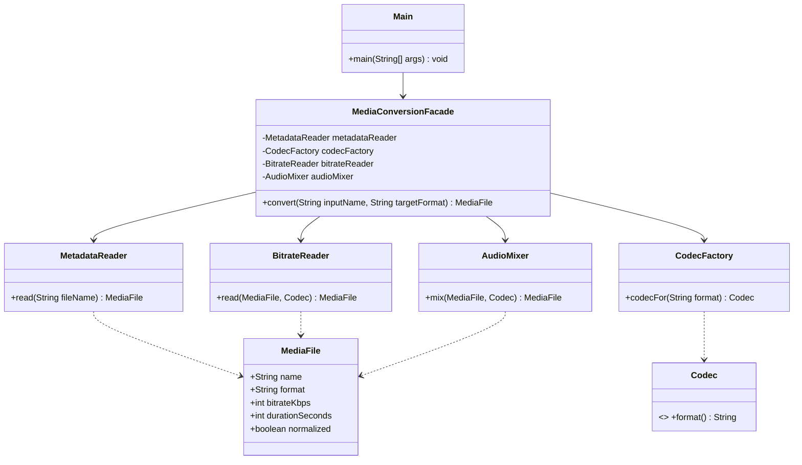

# Media Conversion Facade

A small Java 17 demonstration of the Facade structural design pattern. `MediaConversionFacade` gives a client one operation, `convert(input, targetFormat)`, while coordinating metadata inspection, codec selection, bitrate reading, and audio mixing.

## Requirements

- JDK 17 or later
- No third-party libraries or build tool required

## Run

From the repository root:

```bash
mkdir -p out
javac --release 17 -d out $(find src/main/java -name '*.java')
java -cp out com.example.mediaconverter.client.Main
```

Expected output includes a conversion summary for `concert.wav` and `podcast.mp3`. The example simulates media processing with deterministic in-memory data; it does not read or write real audio files.

To try another input, change the file name in `client/Main.java`. Supported source extensions are `.wav`, `.mp3`, and `.aac`; supported target formats are `mp3`, `aac`, and `wav`. The example rejects unsupported formats and invalid inputs with clear exceptions.

## Project structure

```text
src/main/java/com/example/mediaconverter/
├── client/Main.java
├── facade/MediaConversionFacade.java
└── subsystem/
    ├── AudioMixer.java
    ├── BitrateReader.java
    ├── Codec.java
    ├── CodecFactory.java
    ├── MediaFile.java
    └── MetadataReader.java
```

## UML



The subsystem classes have no reference to the facade. Advanced clients can instantiate and use them directly; the sample client intentionally uses only the facade.

## Conversion flow

1. The facade validates and reads the source metadata.
2. It asks the codec factory for a codec matching the requested output format.
3. The bitrate reader simulates decoding and sets an intermediate bitrate.
4. The audio mixer simulates normalization and packages the result in the target format.
5. The facade returns the converted `MediaFile` summary.

Each subsystem performs its own work. The facade only coordinates their order and presents a compact API.

## Clean Code principles

1. **Meaningful names:** `MediaConversionFacade.convert` states the purpose and outcome. An unclear API such as `run(String a, String b)` forces clients to inspect implementation details.
2. **Single Responsibility:** the facade coordinates steps; `MetadataReader` reads metadata and `AudioMixer` normalizes audio. A monolithic `convertEverything` class would mix these responsibilities.
3. **Small public API:** callers provide an input name and target format instead of constructing codecs and tracking intermediate media objects. This avoids leaking subsystem orchestration into clients.
4. **Encapsulation and low coupling:** subsystem classes know nothing about the facade and remain independently usable. A back-reference from `AudioMixer` to the facade would make the subsystem depend on its wrapper.
5. **Explicit validation and errors:** invalid names and unsupported formats fail with `IllegalArgumentException` and a useful message. Silently choosing an arbitrary codec would hide the actual failure.
6. **Immutable data transfer:** `MediaFile` is a Java record, so each conversion step returns a new value rather than mutating shared state unexpectedly.

## Repository workflow

Suggested incremental commits:

```bash
git add .gitignore README.md
git commit -m "docs: add project overview and run instructions"
git add src/main/java/com/example/mediaconverter/subsystem
git commit -m "feat: implement media conversion subsystem"
git add src/main/java/com/example/mediaconverter/facade src/main/java/com/example/mediaconverter/client
git commit -m "feat: add media conversion facade and demo client"
```

Create an empty GitHub repository, then connect and push it:

```bash
git remote add origin https://github.com/YOUR_USERNAME/media-conversion-facade.git
git push -u origin main
```

Replace `YOUR_USERNAME` with your GitHub username. Submit the repository URL through Moodle as required by your course.
