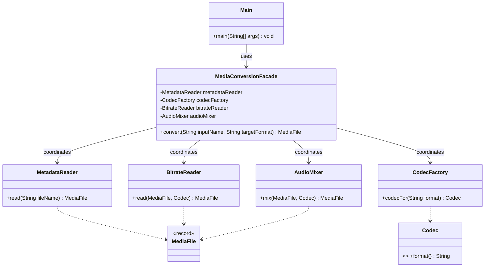

# Media Conversion Facade Report

## 1. Introduction

This project demonstrates the Facade structural design pattern with a simulated media conversion pipeline. Converting a media file normally requires several coordinated operations: inspecting the input, selecting an output codec, decoding or reading the media at an intermediate bitrate, and mixing or normalizing the result. A client that performs these steps itself must know the subsystem classes and their required order.

`MediaConversionFacade` provides one operation, `convert(inputName, targetFormat)`, and coordinates those steps. The simulation uses deterministic metadata and does not manipulate real audio bytes, so it can be built and demonstrated without external media libraries.

## 2. UML Class Diagram

## 3. Conversion Sequence

1. `MetadataReader` validates the file name and supported source extension, then returns sample metadata.
2. `CodecFactory` validates the requested output format and provides the matching codec.
3. `BitrateReader` represents the decoding/read stage and returns an intermediate media value.
4. `AudioMixer` represents normalization and packaging, creating a result with the target extension.
5. The facade returns the final `MediaFile` to the client.

`Main` calls only `MediaConversionFacade`; it does not create or call subsystem objects. The subsystem objects have no back-reference to the facade and can be used by an advanced client directly.

## 4. Clean Code Principles

### 4.1 Meaningful names

The method `convert(inputName, targetFormat)` explains its purpose and its two inputs. An unclear API such as `run(a, b)` would force a client to inspect implementation details before using it.

### 4.2 Single Responsibility

The facade coordinates the pipeline. `MetadataReader` reads metadata, `CodecFactory` selects a codec, `BitrateReader` handles the simulated read/decode stage, and `AudioMixer` normalizes and packages the output. Putting every operation in one large class would make responsibilities harder to understand and change.

### 4.3 A small API that hides subsystem details

The client supplies a source name and target format. It does not need to know which subsystem objects to construct or in what order to call them. Exposing each internal operation from the facade would transfer orchestration back to the client.

### 4.4 Low coupling and independent subsystem classes

Subsystem classes do not import or refer to `MediaConversionFacade`. This keeps them usable independently. Adding a facade back-reference to `AudioMixer` would couple a low-level subsystem class to its wrapper.

### 4.5 Explicit error handling

Blank file names, missing extensions, unsupported input formats, and unsupported output formats cause `IllegalArgumentException` with a specific message. Silently selecting a fallback format would hide a caller error.

### 4.6 Immutable data

`MediaFile` is a Java record. Each pipeline step returns a new value, making the example's state changes explicit and avoiding accidental mutation of shared metadata.

## 5. Conclusion

The facade hides the sequence and coordination of metadata inspection, codec selection, bitrate reading, and audio mixing behind one method. It does not remove or own the subsystem classes: they remain separate and directly accessible to advanced clients. The example focuses on the pattern and simulates media processing; it is not a production audio transcoder.

## 6. GitHub Repository

Repository URL: https://github.com/Batyrkhan8777/assignment-4-facade-pattern
